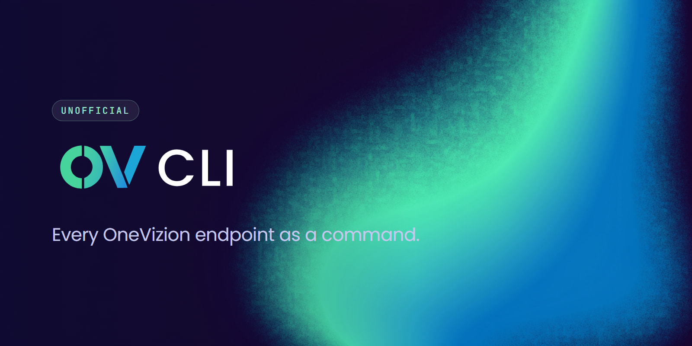

[](LICENSE)
[](https://www.python.org/downloads/)
[](#install)

Command line client for the [OneVizion](https://onevizion.com) API.

Installs as the package `ov-cli` and gives you an `ov` command.

You sign in through a browser window, exactly as you would to use the app. From then on
every endpoint your account can reach is a command, generated from your own instance's
OpenAPI schema, so the coverage matches the server you are actually pointed at rather
than a list someone wrote down. Every command takes `--json`.

```console
$ ov login https://acme.onevizion.com
Logged in to https://acme.onevizion.com as acme (session credential).
Token expires 2026-08-25T13:56:23.
214 API operations available. Try 'ov api tags'.
Now the default instance. Target another with 'ov -i <alias> ...'.

$ ov api tags
OneVizion API (214 operations)
┏━━━━━━━━━━━━━━━━━┳━━━━━┓
┃ Tag             ┃ Ops ┃
┡━━━━━━━━━━━━━━━━━╇━━━━━┩
│ auth-token      │   1 │
│ schema          │   2 │
│ trackor-types   │  14 │
│ users           │   5 │
│ ...             │     │
└─────────────────┴─────┘

$ ov schema get-trackor-types --table
$ ov trackor-types read-trackor CONTRACT 12345
$ ov users get-user-by-id 42 --json | jq .email
$ ov -i globex users get-user-by-id 42     # a different OneVizion system
```

## Install

You do not need Python or anything else installed first.

**Windows** (PowerShell):

```powershell
irm https://raw.githubusercontent.com/Just-Bax/ov-cli/master/install.ps1 | iex
```

**macOS / Linux**:

```bash
curl -fsSL https://raw.githubusercontent.com/Just-Bax/ov-cli/master/install.sh | sh
```

Then open a **new** terminal and run `ov login https://yours.onevizion.com`, or `ov agent`
to do everything from the browser.

The installer fetches [uv](https://docs.astral.sh/uv/), which supplies its own Python, then
installs `ov` into an isolated environment and downloads the browser used for signing in
(about 150MB, once).

If that step is skipped or interrupted, `ov setup` does it, and `ov login`
fetches it itself rather than failing.

<details>
<summary>Already have Python tooling?</summary>

```bash
uv tool install "ov-cli @ https://github.com/Just-Bax/ov-cli/archive/refs/heads/master.zip"
ov setup
```

Or from a clone, for development:

```bash
pip install -e .
ov setup
```
</details>

### Updating

Re-run the same install command. It replaces the existing copy.

### Uninstalling

```bash
uv tool uninstall ov-cli
```

Your settings in `~/.ov` are left alone; delete that folder to remove them.

## Sign in

```bash
ov login https://acme.onevizion.com
```

A browser window opens on the real OneVizion login page. Sign in there and it closes on
its own once you are through.

Single sign-on works unchanged. The wait does not watch the address bar, because with an
external identity provider most of the login happens on someone else's domain and comes
back through a redirect chain. Instead it asks your instance for a token once a second,
from every open tab that is on your host, until one says yes. Microsoft Entra, Okta, SAML
and MFA prompts all just take however long they take, up to `--timeout` seconds
(default 300).

If the instance refuses to issue a token even though you are signed in, the command says
so within a few seconds instead of waiting out the timeout, and names the likely cause.
`ov login <url> --verbose` prints each attempt: which tabs are open, and exactly what each
of the three token requests got back.

The commonest cause is the account lacking the **Widget** module at Read, which is what the
token endpoint requires.

Your password is typed into the real login page. This tool never reads it, never asks for
it, and never writes it anywhere. Token requests only ever go to the host you named, never
to the identity provider.

What gets stored is a **web session token**: the CLI asks the app for one the same way
the built-in widgets do, and it carries exactly your privileges. It dies with your web
session, and `ov logout` revokes it on the server rather than just forgetting it.

Tokens are short-lived. The CLI re-mints one automatically from your session whenever the
old one is close to expiry or the server rejects it, so you rarely see this. Once the web
session itself ends, commands exit 3 and you run `ov login` again.

### More than one system

Sign in to as many instances as you like. Each is stored separately, named after the
first label of its hostname, and the most recent login becomes the default.

```bash
ov login https://acme.onevizion.com          # -> alias "acme"
ov login https://globex.onevizion.com        # -> alias "globex", now the default
ov login https://qa.acme.onevizion.com --as qa
```

```console
$ ov instances
┏━━━┳━━━━━━━━┳━━━━━━━━━━━━━━━━━━━━━━━━━━━━━━━┳━━━━━━━━━┳━━━━━━━━━━━━━━━━━━━━━┓
┃   ┃ Alias  ┃ URL                           ┃ Mode    ┃ Expires             ┃
┡━━━╇━━━━━━━━╇━━━━━━━━━━━━━━━━━━━━━━━━━━━━━━━╇━━━━━━━━━╇━━━━━━━━━━━━━━━━━━━━━┩
│   │ acme   │ https://acme.onevizion.com    │ session │ 2026-08-25T13:56:23 │
│ * │ globex │ https://globex.onevizion.com  │ session │ 2026-08-25T14:02:11 │
│   │ qa     │ https://qa.acme.onevizion.com │ token   │ -                   │
└───┴────────┴───────────────────────────────┴─────────┴─────────────────────┘
```

Pick one per command with `-i`, before or after the subcommand:

```bash
ov -i acme api tags
ov users get-user-by-id 42 -i qa
OV_INSTANCE=acme ov schema get-trackor-types
```

Or change the default:

```bash
ov use acme
```

`-i` accepts the alias, the hostname, the full URL, or any unambiguous prefix of them, so
`-i acme`, `-i acme.onevizion.com` and `-i https://acme.onevizion.com` are the same
instance. If a prefix matches two, the error lists both.

Each instance keeps its **own** cached schema, so the generated commands reflect the
system you are actually pointed at. A group that exists on one and not another is
reported as such rather than as a bare "invalid choice".

```bash
ov tenants               # tenants reachable on the current instance
ov instances --check     # call each one to see whose token still works
ov whoami qa             # detail for one instance
ov logout acme           # revoke and forget one
ov logout --all          # all of them
```

### Instances with several tenants

A OneVizion host can run many tenants, and a tenant is a Program. Your account
belongs to exactly one of them; what spans tenants is your **email**, with a separate user
in each. Signing in always lands you in your own tenant, and the token you get is scoped
to it, so the others are only reachable by switching first.

```bash
ov tenants                                        # what this account can reach here
ov login https://sandbox-2022.onevizion.com --tenant mTRAC
ov -i sandbox-2022/mtrac api tags
```

Each tenant is stored separately and aliased `host/tenant`. The bare host alias keeps
meaning the tenant you sign in to, so nothing changes on single-tenant instances:

```console
$ ov instances
┏━━━┳━━━━━━━━━━━━━━━━━━━━┳━━━━━━━━━━━━━━━━━━━━━━━━━━━━━━━━━━━┳━━━━━━━━━┓
┃   ┃ Alias              ┃ URL                               ┃ Mode    ┃
┡━━━╇━━━━━━━━━━━━━━━━━━━━╇━━━━━━━━━━━━━━━━━━━━━━━━━━━━━━━━━━━╇━━━━━━━━━┩
│ * │ sandbox-2022       │ https://sandbox-2022.onevizion.com │ session │
│   │ sandbox-2022/mtrac │ https://sandbox-2022.onevizion.com │ session │
└───┴────────────────────┴───────────────────────────────────┴─────────┘
```

`-i` takes the tenant name on its own too, so `-i mtrac` is enough when it is unambiguous.

`--tenant` only works where a user with your email already exists in the target tenant,
and only with a browser sign-in: an API token is issued inside one tenant and cannot move.

### Without a browser

If you have an API token from **Admin > Auth Tokens** (type API), use it instead:

```bash
ov login https://acme.onevizion.com --token AbCdEf1234GhIjKl5678:MnOpQr90StUvWx...
```

That token does not expire, so nothing is re-minted and `ov logout` only deletes the
local copy. Invalidate it in the admin page when you are done with it. Session-mode and
token-mode instances can be signed in at the same time.

```bash
ov setup      # re-download the sign-in browser if it goes missing
```

## Full API coverage

`ov` does not ship a hand-written list of endpoints. On login it downloads
`/api/docs/openapi` from your instance and caches it, then builds commands from it. An
instance on a newer release, or with an endpoint yours does not have, gets the commands
it actually serves.

There are three ways into the same set of operations.

### Generated commands

```bash
ov api tags                       # the groups
ov users                          # the commands in one group
ov users get-user-by-id --help    # its real parameters, from the schema
ov users get-user-by-id 42
```

Path parameters are positional, in the order the endpoint declares them. Everything else
is a flag named after the parameter:

```bash
ov trackor-types search-trackors CONTRACT --fields "TRACKOR_KEY,STATUS" --page 1
```

### By reference

```bash
ov api list                       # every operation
ov api list trackor               # search name, path and summary
ov api show trackor-types:read-trackor
ov api schema users:create-user   # the request body's shape
ov api call users:get-user-by-id -p user_id=42
```

`ov api call` is the same machinery with `-p`, `-q` and `-H` instead of generated flags.
It is what to use in a script, since its spelling does not change with the schema.

### Raw

```bash
ov request GET /v3/schema/trackor_types
ov request POST /v3/trackor_types/CONTRACT/trackors -d @new.json
```

`ov request` skips the schema entirely. Use it for endpoints the schema does not describe,
such as the internal API, or when the schema cannot be read at all.

## Sending data

Bodies come from `--data`, or are built up from `--field`:

```bash
ov api call users:create-user -d '{"user_name": "jsmith", "email": "j@acme.com"}'
ov api call users:create-user -d @user.json
cat user.json | ov api call users:create-user -d -

ov api call users:create-user -f user_name=jsmith -f email=j@acme.com
ov api call users:create-user -f 'user_name=jsmith' -f 'roles:=["ADMIN"]'
ov api call trackor-types:create-trackor -p trackor_type=CONTRACT -f fields.STATUS=Open
```

`NAME=VALUE` stores a string, `NAME:=VALUE` parses the value as JSON, and a dotted name
nests. Files upload with `--file field=@path`.

Nothing is sent until you say so:

```bash
ov users get-user-by-id 42 --dry-run
```

## Reading responses

```bash
ov schema get-trackor-types              # highlighted JSON
ov schema get-trackor-types --json       # plain JSON, pipe-safe
ov schema get-trackor-types --table      # a table, when the response is a flat list
ov api call reports:export-report -p report_id=7 --out ./report.xlsx
ov request GET /v3/server_info --raw     # the body exactly as it arrived
```

`--json` never colours or wraps, so `ov ... --json | jq` is always safe.

## Settings

```bash
ov config                                    # show settings, paths and signed-in instances
ov config set spec_ttl_seconds 3600
ov config clear-cache
ov spec fetch                                # re-read the API schema now
```

| Setting | Default | Purpose |
|---|---|---|
| `spec_group` | `v3` | which OpenAPI group to generate commands from |
| `download_dir` | `~/.ov/downloads` | where `--out` lands when given a bare name |
| `cache_ttl_seconds` | `0` (off) | how long GET responses are reused |
| `spec_ttl_seconds` | `86400` | how long the schema is reused before refetching |
| `timeout_seconds` | `60` | HTTP timeout |
| `color` | `true` | coloured output |
| `verify_tls` | `true` | verify TLS certificates |

Response caching is off by default, because a stale trackor is worse than a second
request. Turn it on with `ov config set cache_ttl_seconds 600`; only bodiless GETs are
cached, and entries are keyed per instance. Pass `--refresh` to any command to ignore both
the response cache and the schema cache for that run.

## Read-only mode

Set `OV_READONLY=1` to make `ov` refuse anything that could change data:

```bash
OV_READONLY=1 ov request GET /v3/server_info      # allowed
OV_READONLY=1 ov request DELETE /v3/users/7       # exit 7
```

Allowed: every GET, trackor searches, `POST /v3/sql/test` (SELECT only) and component
exports. Web UI requests are limited to the API schema and sign-out. Everything else stops
with exit 7 before a request is sent. Useful when handing `ov` to an AI agent.

## The agent

```bash
ov agent          # or: ov ui
```

Starts a local web app at http://127.0.0.1:5180 and opens it in your browser: OV Agent,
a chat with an AI Tier 3 engineer that works on your OneVizion instances through `ov`.

- **Support cases:** type a case number or paste a trackor link. It reads the whole case
  from trackor.onevizion.com (fields, chat, attachments, emails), moves to the affected
  instance, finds the root cause with evidence, checks existing Issues, proposes fixes as
  diffs, and writes the reply for the case chat.
- **Anything else:** ask a question ("which rules failed in the last 24 hours?"), paste
  errors, attach screenshots, emails or logs.

It shows each API call and SQL query it makes, and ends an investigation with findings and
the evidence it checked.

The first screen walks you through setup:

1. Sign in to GitHub. The agent runs on GitHub Copilot, so the account needs a Copilot
   subscription; you pick the model.
2. Sign in to at least one instance (the same browser sign-in as `ov login`).
3. Pick a default model and instance. Both can be changed per run.

Read-only by default: every call runs with `OV_READONLY=1`. Turn on **Allow changes** for
a run and the agent may apply changes, but each one shows you the exact `ov` command and
waits for your **Approve**.

In **Settings**:

- **Skills** are instructions added to every run. Four ship with `ov`: OneVizion Basics
  (where rules, automations, notifications, imports, reports, modules and workflows live,
  and how their runs and errors are logged), Working Style, OV CLI, and TCE Best Practices
  (trackor cases, the troubleshooting workflow, the case reply style). Edit them, switch
  any off, or write your own.
- **Sources** are code and docs the agent can search: a local folder (a checkout of
  platform code, a docs export) or a git URL it clones for you. Describe each one so the
  agent knows when to look. Add your clone of the platform repo as `platform` so it can
  read table DDL and search for error text.
- **Instances** lists your `ov` sign-ins and signs in to new ones.

Nothing leaves your machine except calls to your instances and to GitHub Copilot. The
server listens on 127.0.0.1 only. History, uploads and clones live in `~/.ov/agent`; the
GitHub token is kept in the OS keyring with your other credentials.

`ov agent --port 5181` picks another port; `--no-open` skips opening the browser.

## Files on disk

Everything lives in `~/.ov` (`ov --home` prints the path, `OV_HOME` overrides it):

```
~/.ov/
  config.json      settings and the list of signed-in instances, no secrets
  browser/         Playwright profile, so login remembers you
  spec/            cached OpenAPI schema, one file per instance and group
  cache/           cached API responses
  downloads/       files written by --out
  agent/           agent history (agent.db), run workspaces, uploads, cloned sources
```

Bearer tokens, session cookies and the agent's GitHub token go to the OS keyring: Windows
Credential Manager, macOS Keychain, or the Secret Service on Linux. Where no keyring is
available (a headless Linux box, for example) they go to `~/.ov/credentials.json` instead,
written owner-only, and `ov` says so once. `OV_CREDENTIALS=file` forces that file. Configs
from older versions that kept tokens in `config.json` are moved over the first time they
are read.

Directories are created owner-only and files are replaced atomically under a lock, so two
`ov` processes refreshing tokens at once cannot corrupt the config. On Windows the
permission bits are not enforced; your profile's ACL is what protects `~/.ov` there.

## Exit codes

| Code | Meaning |
|---|---|
| 0 | success |
| 1 | general error, including an instance that could not be reached |
| 2 | bad command line |
| 3 | not logged in, or the session expired |
| 4 | no such operation, record or instance |
| 5 | the API returned an error, or the schema could not be read |
| 6 | authenticated, but the server answered 403 |
| 7 | blocked by read-only mode (`OV_READONLY`) |

## Privileges

The CLI can only reach what your account can. Three matter for the CLI itself:

| Module | Priv | Needed for |
|---|---|---|
| Widget | Read | minting the web session token, so `ov login` without `--token` |
| API Docs | Read | reading the schema, so the generated commands and `ov api` |
| Web Services | Read | essentially every `/api/v3` endpoint |

Without **API Docs** you still get `ov request`. Without **Widget** you can still sign in
with `--token`.

Note that OneVizion does not answer 403 for every privilege failure. A missing field-level
privilege comes back as HTTP 500 with an explanatory message, so it surfaces as exit 5
rather than exit 6. Read the message, not the exit code, when a call is refused.

## Use from an AI agent

`ov agent` is the built-in one. To use `ov` from another agent (Claude Code, Copilot CLI,
your own): every command speaks `--json` and maps failures onto distinct exit codes, so `ov`
works as a tool. [`SKILL.md`](SKILL.md) is the brief: auth model, how to discover
endpoints, JSON shapes, exit codes, and the operations the agent should leave to you.

It is told not to run `ov login`, which waits on a browser window, and not to read the
stored credentials. Run the agent with `OV_READONLY=1` if it should only look.

## Contributing

Issues and pull requests are welcome.

```bash
git clone https://github.com/Just-Bax/ov-cli
cd ov-cli

uv run --extra dev pytest -q
uv run --extra dev ruff check src tests
uv run --extra dev ruff format --check src tests
```

CI runs the same on Windows, Linux and macOS with Python 3.11 to 3.13.

The agent's UI is React in `web/`. Its build is committed to `src/ov/agent/static`, so
installing `ov` never needs Node. After changing it:

```bash
cd web
pnpm install
pnpm dev          # http://localhost:5179, proxies /api to a running `ov agent`
pnpm check        # typecheck + prettier
pnpm build        # writes src/ov/agent/static; commit the result
```

CI fails if the committed build does not match `web/`.

The layout follows the request path: `client.py` speaks HTTP and owns the two auth
schemes, `auth.py` mints tokens, `session.py` keeps one credential set per instance and
resolves what `-i` names, `spec.py` turns the OpenAPI document into the `Operation`
objects everything else works from, `invoke.py` maps command line input onto one HTTP
request, `service.py` is the only API access the commands get, and `cli/commands/` holds
one module per command group. `cli/dynamic.py` is what turns a schema tag into commands.
`agent/` is the agent server: `server.py` (HTTP API and the built UI), `run.py` (the
model loop), `tools.py` (what the model may call, each `ov` call a read-only subprocess),
`copilot.py`, `skills.py` and `sources.py`. `agent/state.py` mirrors `web/shared/reduce.ts`.

Tests use a recorded OpenAPI document and a mock transport, so `pytest` never touches the
network. `test_login_browser.py` is the exception: it starts a real headless Chromium
against a local stand-in for OneVizion, because the sign-in wait depends on how Playwright
delivers browser events and that cannot be checked with fakes. It skips itself if the
browser is not installed.

## License

[MIT](LICENSE) - Copyright (c) 2026 Isfandiyor Baxtiyorov.

This is an unofficial client. It is not affiliated with, endorsed by, or supported by
OneVizion, Inc. It reads only what your own account can already see, using your own
session.
